<div align="center">


### Your own Jellyfin library, with a streaming-service feel. On the web and on your TV.

Independent and open source. No accounts, no telemetry, no server of ours: it talks only to the Jellyfin server **you** run.

[](https://github.com/sebastianvelezg/JellyFlix/actions/workflows/ci.yml)
[](https://github.com/sebastianvelezg/JellyFlix/releases)
[](LICENSE)
[](https://jellyfin.org)
[](#what-each-app-has)
[](web/README.md#host-it-for-your-devices)
[](CONTRIBUTING.md)

[**Features**](#-features) ·
[**Play on…**](#-play-on-another-device) ·
[**Make it yours**](#-make-it-yours) ·
[**Administration**](#%EF%B8%8F-for-server-administrators) ·
[**Plugins**](#-plugins-and-integrations) ·
[**Get started**](#-get-started) ·
[**FAQ**](#-faq) ·
[**Contributing**](#-contributing)

<br>

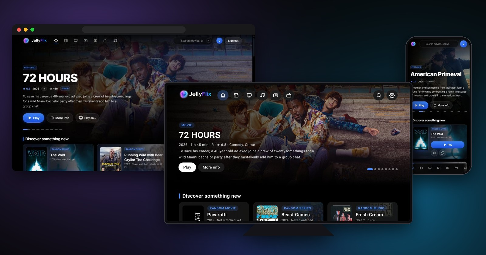

<sub>Real screenshots from the author's own Jellyfin server.</sub>

</div>

<br>

## Why Jellyflix?

Jellyfin is a wonderful server, and its stock clients are powerful and plain. Jellyflix is for people who want the *front door* to their library to feel like the services they are used to:
a banner that mixes movies and series, rows that follow what you are watching, a random pick when you cannot decide, a look you can change to your taste, and a player and a remote-friendly TV app that just work.

- **Pure client.** Static files for the web, one APK for the TV. Nothing to sign up for, nothing that phones home.
- **Your server does the work.** The apps never transcode; they tell Jellyfin what the device can play and use what it answers.
- **Two apps, one look.** The web app and the TV app share their design, their rules and their sections, so moving between them feels natural.
- **Yours to shape.** Backgrounds, accent colours, poster size and the rows of the home page are all your choice, on both apps.
- **Run your server from it.** Server administrators get tools to scan, fix, edit and manage, right where they watch (web app).

## ✨ Features

<table>
<tr>
<td width="33%" valign="top">

**A home that follows you**

A banner mixing movies and series, *Discover something new* (a random movie, a series you never started, an album), Continue watching, Next up, Watch later, "New since your last visit", "Coming up" and "Because you watched…".

</td>
<td width="33%" valign="top">

**Your whole library**

Movies, series, anime, music videos, books, collections and music, each with a banner, sort, filters (genre, decade, rating, 4K…), an A–Z jump, cast pages and search. Music keeps playing while you browse.

</td>
<td width="33%" valign="top">

**A real player**

Direct play or the server's HLS conversion, audio tracks, subtitles you can style and time-shift, skip intro and credits, chapters, seek-bar pictures, next episode, a quality limit, and progress synced to Jellyfin.

</td>
</tr>
<tr>
<td valign="top">

**Music and lyrics**

Albums, artists, playlists, a full-screen player with a reorderable queue, a sleep timer, and lyrics that follow the song (timed lyrics from your server's lyrics plugin).

</td>
<td valign="top">

**Organise**

Playlists of movies and episodes that play through, a one-click Watch later, favorites, and a menu on every poster.

</td>
<td valign="top">

**Sign in without typing**

Quick Connect: a six-digit code you approve from another device, so no password on a TV remote.

</td>
</tr>
<tr>
<td valign="top">

**One controls the other**

Start a movie or a song on your TV, your phone or another computer, control it from any of them, and hand over what is playing without losing your place.

</td>
<td valign="top">

**Your stats**

Hours watched, your months and genres, what you watched twice. With the Playback Reporting plugin: the real time played, when you watch and on which devices.

</td>
<td valign="top">

**Made for the sofa**

D-pad navigation, a Google TV *Continue watching* row, a screen margin and text size for TVs that crop the picture, and an Info panel that tells you why the server is converting.

</td>
</tr>
<tr>
<td valign="top">

**Plugin aware**

Uses Intro Skipper, lyrics, subtitle, box-set, artwork and playback-reporting plugins when your server has them. Nothing breaks when it does not.

</td>
<td valign="top">

**Easy to host**

A tiny Docker image (`amd64` and `arm64`), `docker compose up`, plain Node, or any static web server. Your Jellyfin address is a setting, not a rebuild. Installable as an app (PWA).

</td>
<td valign="top">

**English and Spanish**

Switchable in Settings in both apps, with a test that keeps every text translated. Accessibility is checked automatically (WCAG 2.1 A and AA).

</td>
</tr>
<tr>
<td valign="top">

**Books and audiobooks**

A Books library gets its own tab. The web app reads **EPUB**, **PDF** and **comics (CBZ)** in its own reader (dark, light or sepia pages) and remembers where you stopped; audiobooks play in the music player on both apps.

</td>
<td valign="top">

**Live TV**

Your channels with what is on each, a guide, favorites and the live stream your server provides: channel up and down on the arrow keys or the remote, and a quality choice on the web.

</td>
<td valign="top">

**A menu that is yours**

The buttons at the top can show icons and names, only icons or only names, in the order you want, and the ones you do not use can be turned off. The bar scrolls instead of cutting anything off.

</td>
</tr>
</table>

### What each app has

| | **Jellyflix Web** | **Jellyflix TV** |
|---|---|---|
| Home banner, Discover, rows that follow you | ✅ | ✅ |
| Movies, Series, Anime, Music videos, Music, Collections | ✅ | ✅ |
| Books and audiobooks | ✅ reads EPUB, PDF and CBZ; plays audiobooks | ✅ plays audiobooks (books to read are for the web) |
| Live TV: channels, guide, favorites | ✅ | ✅ |
| Filters, A–Z jump, search | ✅ | ✅ |
| A menu on every title (watched, favorite, Watch later, playlists) | ✅ "⋯" | ✅ hold OK |
| Playlists, Watch later, New since your last visit, Coming up | ✅ | ✅ |
| Music, lyrics, queue, sleep timer | ✅ | ✅ |
| Seek-bar pictures, skip intro / credits, chapters, audio and subtitle tracks | ✅ | ✅ |
| Appearance: backgrounds, accents, poster size, home rows, top menu (icons or names, order, hide) | ✅ (+ any colour) | ✅ |
| Back up your look on the server | ✅ | ✅ |
| Your stats, and Playback Reporting data | ✅ | ✅ |
| Sign in with a code (Quick Connect) | ✅ (and approve a code) | ✅ |
| Play on another device | ✅ controls and receives | ✅ receives |
| Plugins page | ✅ run their tasks | ✅ read only |
| **Administration and the title editor** | ✅ | — |
| Settings export and import, subtitle files from your device, installable (PWA) | ✅ | — |
| Plays at the picture's own size, frame-rate matching, Info panel, version picker | — | ✅ |
| Google TV *Continue watching* row, Instant Home | — | ✅ |

## 📡 Play on another device

Start something on one screen, watch it on another. Every movie, episode, album and playlist has a **Play on…** button that lists your devices Jellyfin can control: the TV app, and the web app open on a phone, a tablet or another computer.
Pick one and the title starts there, resuming where you left off, while a small floating remote on the screen you are holding shows what is playing, with a position bar you can drag, previous / next, pause, ±30 s and stop.

- **Phone → TV, web → TV, computer → phone:** send it from wherever you are and control it from there.
- **Hand over what is playing:** the video and music players have **Play on…** too, and the movie or the songs carry on in the other device from the same second.
- **Take it back:** when a device is already playing, the app offers "On *device*: *title*", and its remote has **Play here** to bring it to the screen you are on.
- Nothing is installed or woken up: the app has to be open on the device that receives it. It works through your own Jellyfin server and nothing else.

<table>
<tr>
<td width="58%" valign="middle">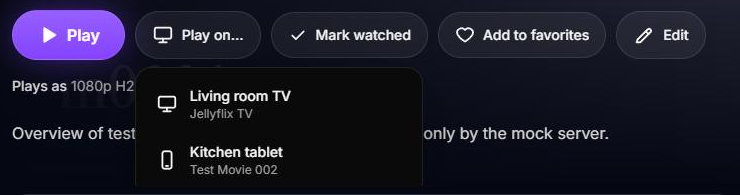</td>
<td width="42%" valign="middle">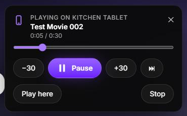</td>
</tr>
</table>

## 🎨 Make it yours

Settings → **Appearance**, in both apps. The choices stay on the device; the whole app follows at once.

- **Six backgrounds:** true black, charcoal, midnight, dusk, pine and cocoa.
- **Accent colours:** eight presets, and on the web any colour you pick. Text on the accent is adjusted automatically so it stays readable, and every preset is tested for WCAG contrast on every background.
- **The top menu:** icons and names, only icons or only names (with both, the names give way to the icons when they do not fit), the order of the buttons and which ones show. Home always stays.
- **Poster size:** compact, comfortable or large; rows and grids fit one more or one fewer column. On the web also the interface size, the space between rows and the banner height.
- **Your Home page:** the banner and every row on or off, in the order you want (Discover, Continue watching, Next up, Watch later, playlists, favorites, New since your last visit, Coming up, the latest movies, collections, new series, new anime, new music videos, new books, new music…).
- **Take it with you:** back your look up on your own Jellyfin server and load it on another device (a button, nothing automatic); the web app can also export and import all its settings as a file.

<table>
<tr>
<td width="50%">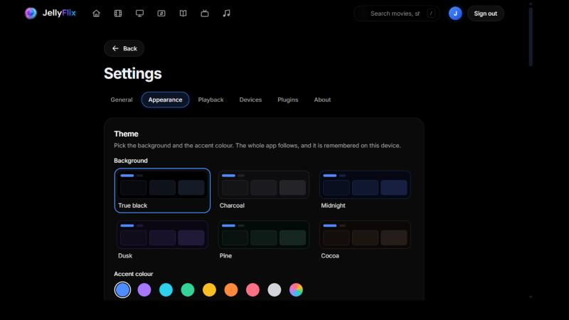</td>
<td width="50%">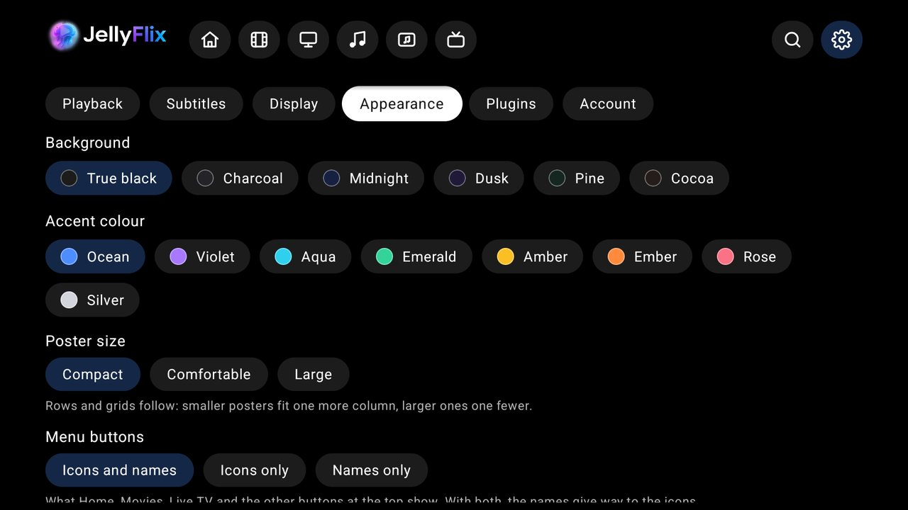</td>
</tr>
<tr>
<td>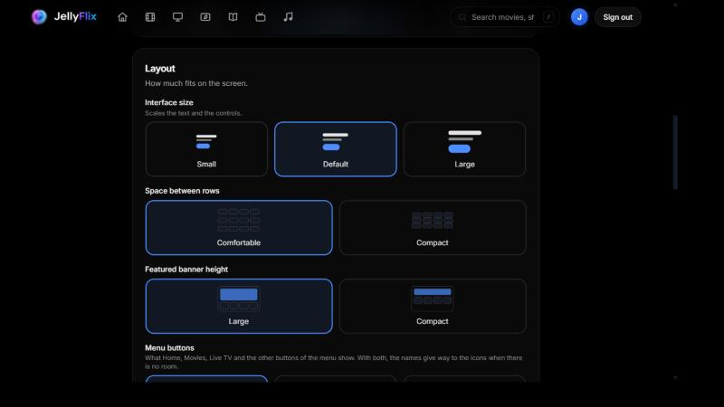</td>
<td>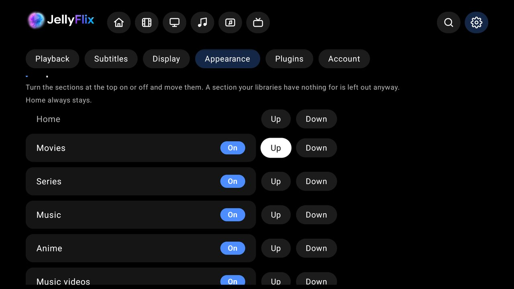</td>
</tr>
</table>

## 🛠️ For server administrators

Sign in to Jellyflix Web with an **administrator** account and **Settings → Open administration** appears, plus an **Edit** button on every title. Everything is also in Jellyfin's dashboard; Jellyflix puts the everyday parts one click away from where you watch.

- **Library:** scan one library or all, list **the titles the server could not recognise** (with their path, so you can see what is wrong with the file name), and change **up to 100 titles at once** (mark watched, refresh, replace details, lock, add a tag) after a preview.
- **Title editor:** edit details with a review of what changes, identify a title in the metadata providers, refresh it, change its pictures (from the providers or your own file) and put edited details back from a local history.
- **Accounts:** who is an administrator or disabled, each account's allowances (libraries, playing, converting, parental rating, sessions, downloads, deleting…), new accounts and new passwords.
- **Devices:** who is connected and what they are watching, whether the server converts it and why; send a message, stop a playback, sign a device out, revoke an API key.
- **Server:** version, failed tasks, notices (an update is available, a restart is pending), scheduled tasks you can start or stop, and the activity log.

It is built to be safe: **nothing changes without a review**, destructive actions need you to type a name, the page **refuses anything that would lock you out**, API keys show only their last four characters, and **the server stays the authority**
(an account that is not an administrator is refused by Jellyfin itself, and sees none of this). Details are in [web/README.md](web/README.md#administration).

<p align="center">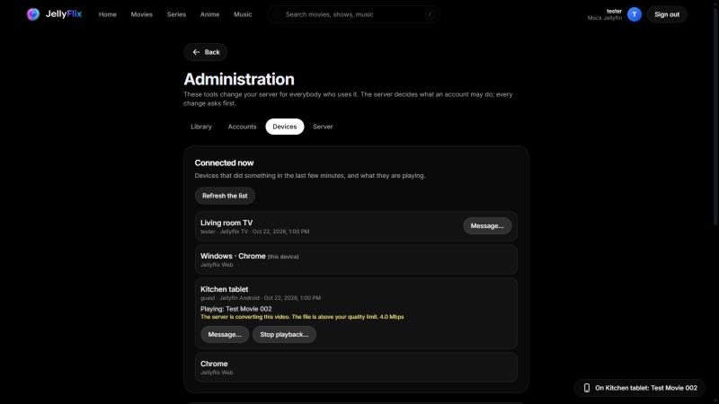</p>

## 🧩 Plugins and integrations

Jellyflix works with a plain Jellyfin and gets better with plugins. It recognises them, shows their state, and (on the web, for administrators) runs their scheduled tasks after telling you what they do.

| Plugin | What you get in Jellyflix |
|---|---|
| **Intro Skipper** (or any segment provider) | Skip intro / recap / credits / preview buttons while you watch; "Find intros" for a season |
| **Lyrics** (for example LrcLib) | Lyrics in the music player, timed ones that follow the song, and "Find timed lyrics" |
| **Open Subtitles** | Shows its state and its "Download missing subtitles" task |
| **TMDb Box Sets** | The collections page: it builds the box sets |
| **Fanart.tv**, **AniList** | Recognised; they work when a title's details are refreshed |
| **Playback Reporting** | **Your stats** gains the real time played, the hours of the day you watch at and your devices, plus its backup and trim tasks |

Playback Reporting is read through its own query route with a few fixed, read-only questions about the signed-in user, and only for administrators; without the plugin the stats page is exactly as before.

## 🌐 Jellyflix Web

A fast, installable web app that talks directly from your browser to your Jellyfin server. Host it on a NAS or a Raspberry Pi and open it from any device in the house.

<table>
<tr>
<td width="50%">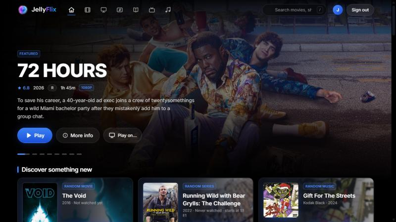</td>
<td width="50%">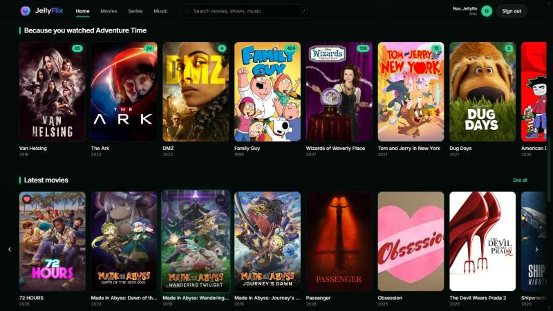</td>
</tr>
<tr>
<td>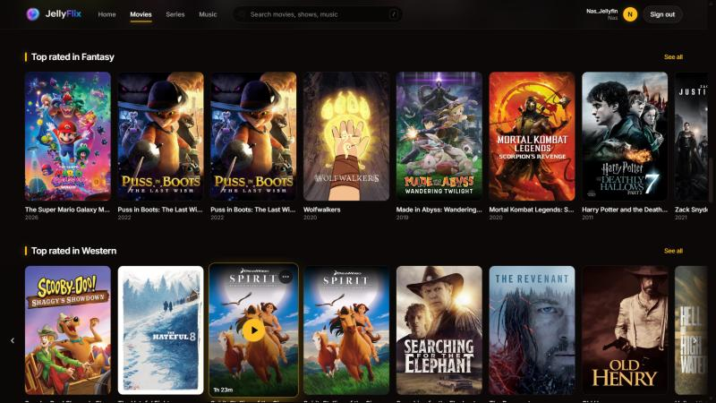</td>
<td>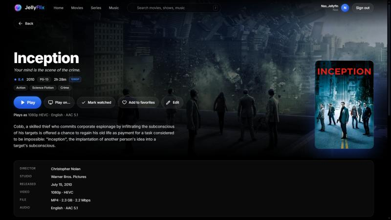</td>
</tr>
<tr>
<td>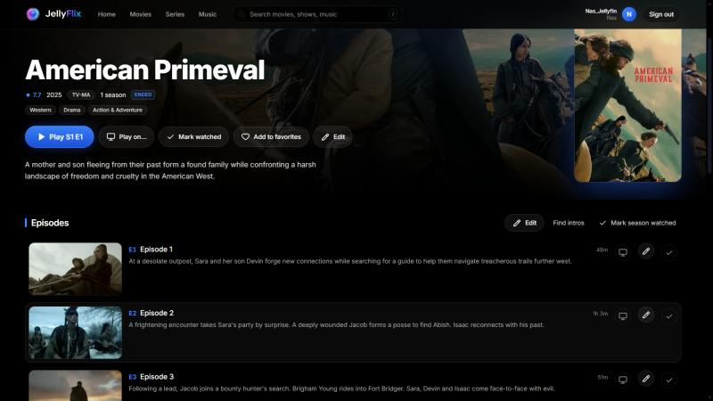</td>
<td>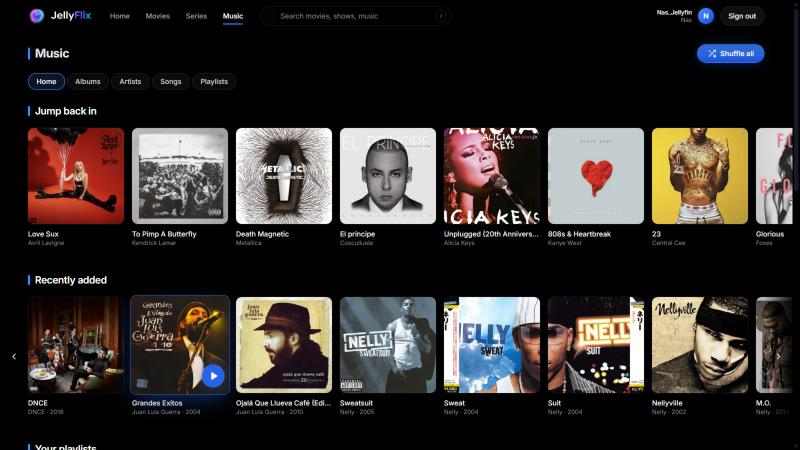</td>
</tr>
<tr>
<td>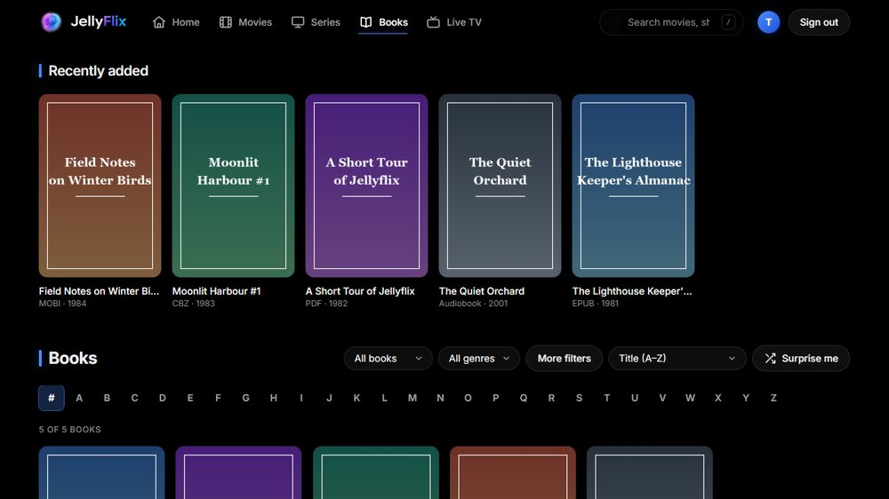</td>
<td>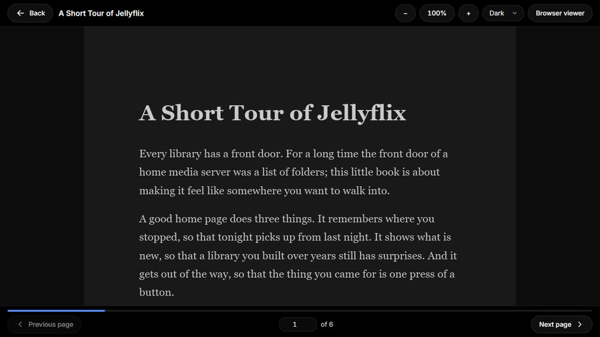</td>
</tr>
<tr>
<td>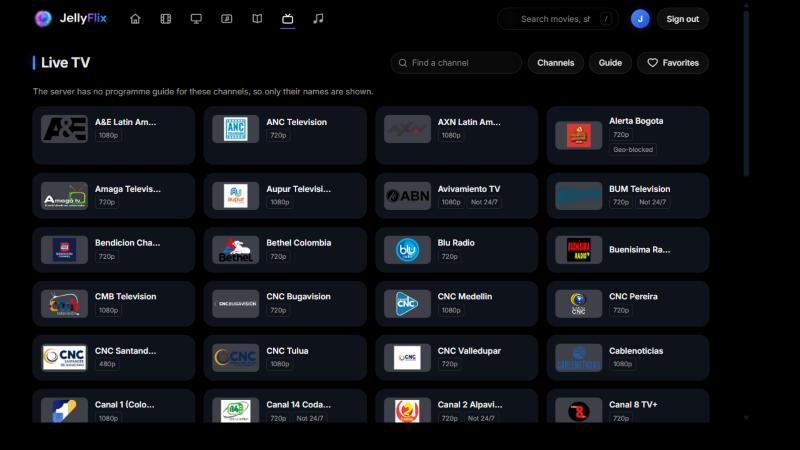</td>
<td>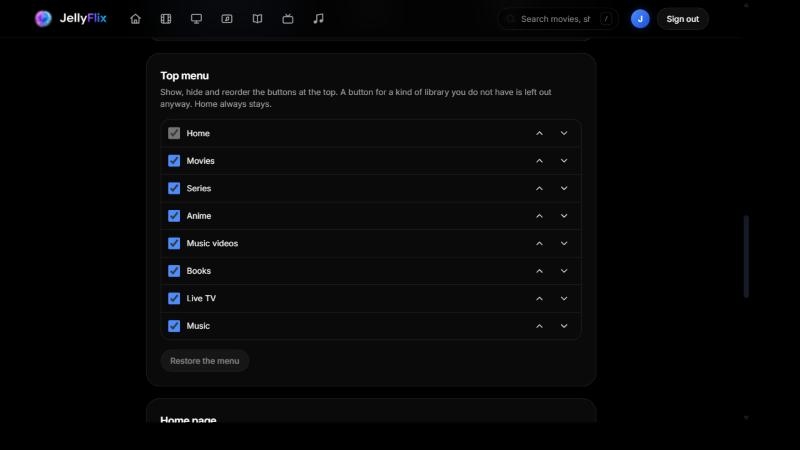</td>
</tr>
</table>

<p align="center">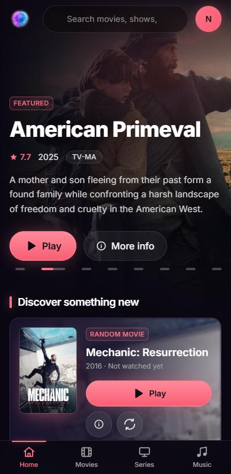</p>

**Host it with Docker** on a NAS or any always-on machine:

```bash
git clone https://github.com/sebastianvelezg/JellyFlix.git
cd JellyFlix/web
docker compose up -d --build
```

Then open `http://<IP address of that machine>:8080` from any device on your network (`localhost` only works on that same machine). The step-by-step guide, with every method, the two addresses you need to understand,
HTTPS and troubleshooting, is in **[web/README.md](web/README.md#host-it-for-your-devices)**.

## 📺 Jellyflix TV

A native app built for a remote control and a TV seen from the sofa: big targets, predictable focus, a banner you can skim with the D-pad.

<table>
<tr>
<td width="50%">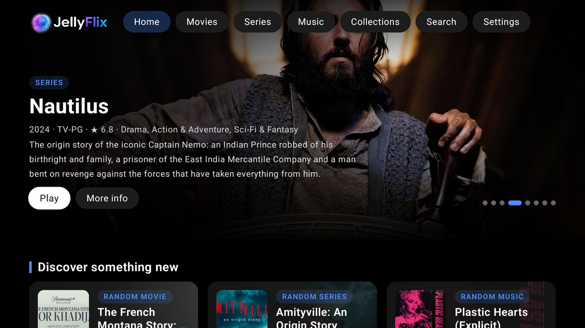</td>
<td width="50%">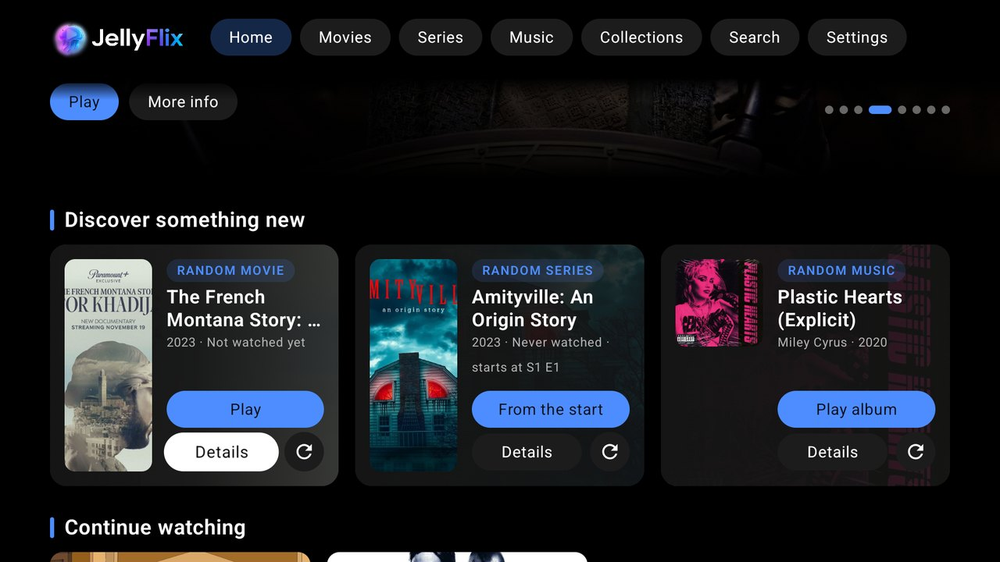</td>
</tr>
<tr>
<td>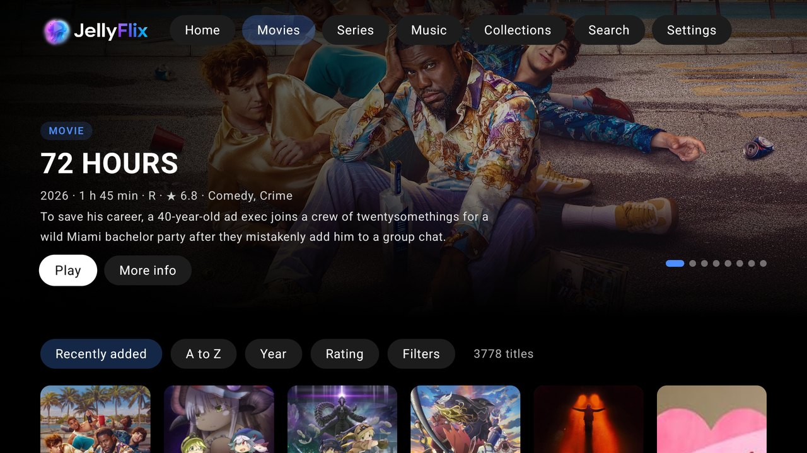</td>
<td>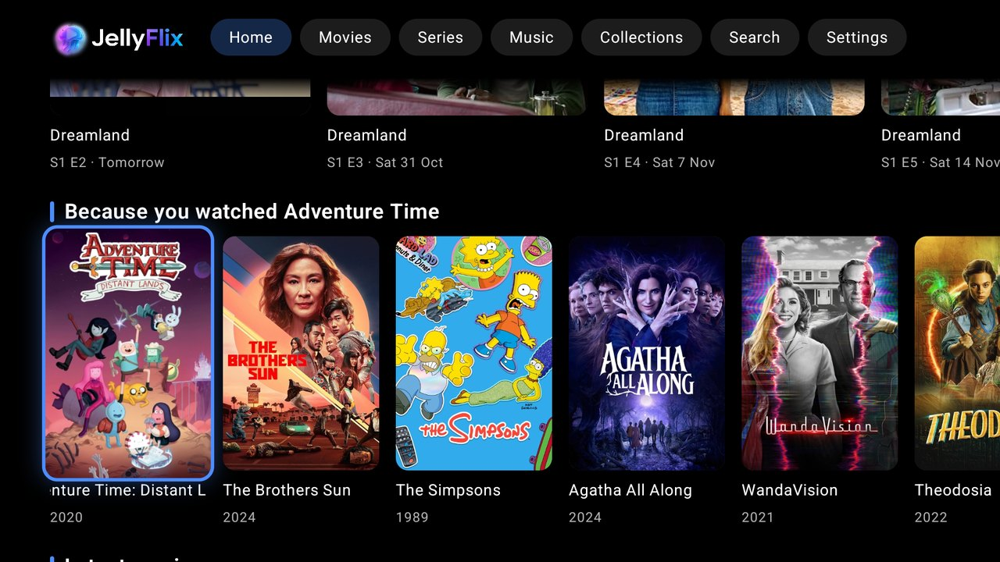</td>
</tr>
<tr>
<td>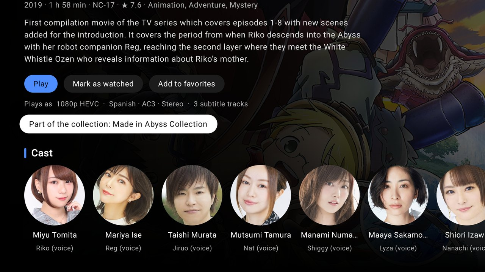</td>
<td>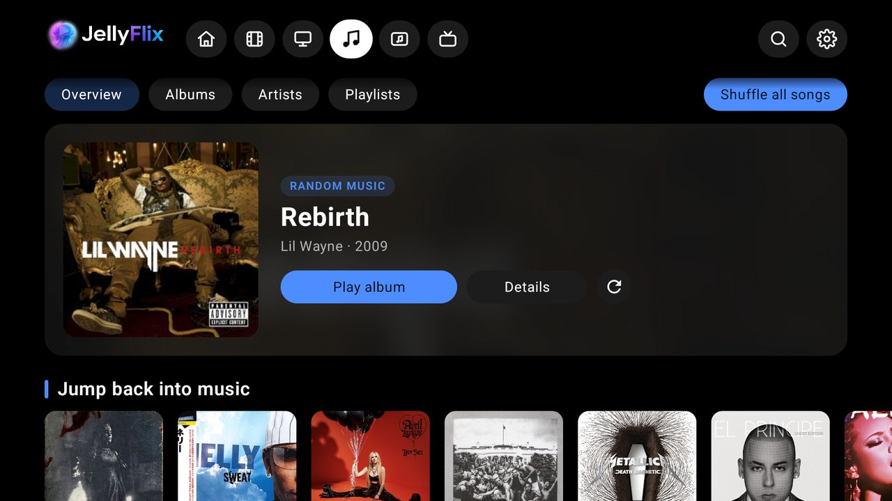</td>
</tr>
<tr>
<td>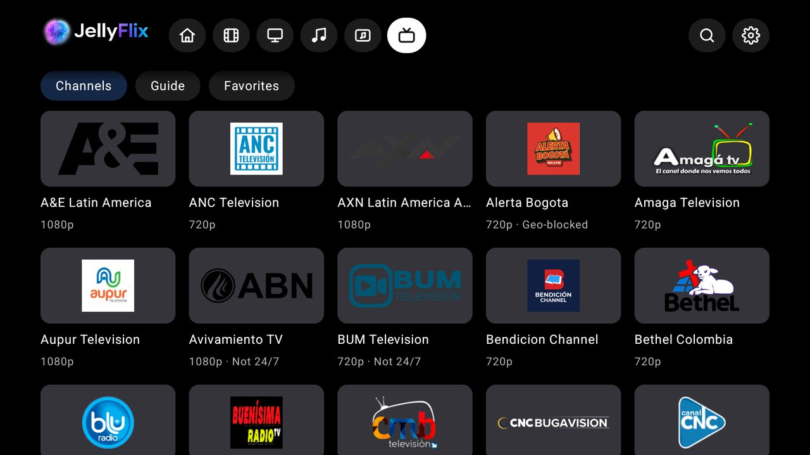</td>
<td></td>
</tr>
</table>

<sub>Jellyflix TV running on a Google TV emulator against a real Jellyfin server. Compatibility and testing notes are in [tv/README.md](tv/README.md#testing-and-compatibility).</sub>

**Install it** by sideloading the APK (adb over Wi-Fi, a USB stick or the Downloader app). **[tv/README.md](tv/README.md#install-it-on-your-tv)** walks through the whole process: getting the APK (download it or build it), putting it on the TV, signing it with your own key and the first sign-in.

## 🚀 Get started

You need a **Jellyfin server** (10.10 or newer; developed against 12.x) and a normal Jellyfin user. No API key and no administrator account (only the administration tools and the Playback Reporting data need one).

> **One thing to know:** Jellyflix asks for your **Jellyfin server's address** as the device reaches it: the IP address (or domain name) of the machine that runs Jellyfin, such as `http://192.168.x.x:8096`.
> Never `localhost`: that always means the device you are holding. The hosting guide explains this in detail.

| I want to… | Do this |
|---|---|
| Host the web app on my NAS or home server | [web/README.md → Host it](web/README.md#host-it-for-your-devices): Docker Compose, a ready-made image, NAS apps, Node, any web server |
| Put the TV app on my TV | [tv/README.md → Install it on your TV](tv/README.md#install-it-on-your-tv) |
| Work on the code | [CONTRIBUTING.md](CONTRIBUTING.md): `cd web && npm install && npm run dev` runs the development server for the web app |

Prebuilt downloads (a web bundle, a Docker image and a TV APK) are attached to each [GitHub release](https://github.com/sebastianvelezg/JellyFlix/releases).

### Compatibility

| | Developed on | Expected to work |
|---|---|---|
| **Jellyfin server** | 12.x | 10.10 and newer |
| **Web browsers** | Chrome | Edge, Firefox, Safari |
| **TV** | Google TV (Android 16, API 36) on an emulator | Android TV and Google TV, Android 9 and newer |

## 🔒 Privacy and principles

These are rules of the project, not just how it behaves today. A contribution that breaks one will not be merged.

- **Talks only to your Jellyfin server.** No analytics, no crash reporting, no ads, no third-party calls unless *you* turn on something that needs one.
- **No credentials or server addresses in the source.** Your password is sent once to your server and never stored; only a revocable session token is kept.
- **No backend of ours.** The web app is static files and the TV app is a single APK. There is nothing to sign up for.
- **Your server does the heavy lifting.** The apps never transcode.
- **Both apps stay equivalent**, and every text exists in English and Spanish.

## ❓ FAQ

<details>
<summary><b>Is it affiliated with Jellyfin?</b></summary>

No. Jellyflix is an independent client. "Jellyfin" is the name of the media server it connects to.
</details>

<details>
<summary><b>Does it need an admin account or an API key?</b></summary>

No. A normal Jellyfin user is enough. An administrator additionally gets the administration tools, the plugins page and the Playback Reporting data; nothing else requires it.
</details>

<details>
<summary><b>Can I use it outside my home network?</b></summary>

Yes, as far as your Jellyfin server can be reached from there. If you serve the web app over HTTPS, your Jellyfin must also be HTTPS (browsers block mixed content). See [the hosting guide](web/README.md#https-cors-and-reverse-proxies). Expose your server to the internet only if you understand the risks.
</details>

<details>
<summary><b>Is my password safe?</b></summary>

It is sent only to your own server while signing in and never stored. After that the app keeps a revocable session token (you can revoke it from the Jellyfin dashboard). Both apps can sign in with Quick Connect so you never type a password. Details are in [SECURITY.md](SECURITY.md).
</details>

<details>
<summary><b>Can the administration tools break my server?</b></summary>

They can change it, as Jellyfin's own dashboard can, so every change shows a review first and the dangerous ones ask you to type a name. They refuse to lock you out, and they leave out the riskiest actions on purpose (restarting the server, installing plugins, deleting accounts). Try them first against the mock server (`npm run mock`).
</details>

<details>
<summary><b>Why does a video "convert" or stutter?</b></summary>

When a file's format is not playable by the device, Jellyfin converts it on the fly. That work is done by your server, not by Jellyflix. The TV app's Info panel (press INFO while playing) and the web player's playback details tell you why it was converted, and the settings let you cap the quality or refuse conversion.
</details>

<details>
<summary><b>Can I read books with it?</b></summary>

On the web app, yes: EPUB, PDF and comic archives (CBZ) open in its own reader, which keeps your place in this browser. Audiobooks play in the music player on both apps. The TV app does not show books to read; it says so and points to the web app or a phone. Other formats (Mobi, RAR comics) can be downloaded. Your account has to be allowed to download files.
</details>

<details>
<summary><b>Is it on the Play Store / App Store?</b></summary>

Not at the moment. The TV app is installed by sideloading and the web app is hosted by you.
</details>

<details>
<summary><b>Does it work with Plex, Emby or Kodi?</b></summary>

No, only Jellyfin.
</details>

## 🛣️ What could come next

Jellyflix 1.1 is complete for daily use. Ideas, in no particular order, and where a contribution would help most:

- **Playback:** subtitle search through your server's plugin (opt-in), SyncPlay (watch together), recording and timers for live TV, a version picker on the web.
- **Books:** a reader for the TV app, Mobi and RAR comics.
- **Sign in:** find servers on the network, several servers and users.
- **Reach:** Fire TV, more languages, a public demo of the web app.
- **Quality:** browser tests in CI, a mock server the TV app can use, and testing on more physical TVs (HDR, 4K and frame-rate switching vary a lot between models).

Have an idea? [Open an issue](https://github.com/sebastianvelezg/JellyFlix/issues/new/choose).

## 🤝 Contributing

Issues, translations and pull requests are welcome, from a typo to a feature. Start with [CONTRIBUTING.md](CONTRIBUTING.md): it covers the setup, the tests, the project rules and how to add a language.
By taking part you agree to the [Code of Conduct](CODE_OF_CONDUCT.md). Found a vulnerability? See [SECURITY.md](SECURITY.md).

Reports from different servers, libraries, browsers and TVs are very welcome. If something breaks for you, please open an issue.

## 📚 Documentation

| | |
|---|---|
| [web/README.md](web/README.md) | Jellyflix Web: every feature, hosting step by step, the security model, administration, plugins, architecture and testing |
| [tv/README.md](tv/README.md) | Jellyflix TV: every feature, the remote control, installing it on a TV, how it is built, testing and compatibility |
| [CONTRIBUTING.md](CONTRIBUTING.md) | Setup, tests, the rules of the project, adding a language |
| [CHANGELOG.md](CHANGELOG.md) | What changed in each version |

Project files: [CODE_OF_CONDUCT.md](CODE_OF_CONDUCT.md) · [SECURITY.md](SECURITY.md) · [THIRD_PARTY_NOTICES.md](THIRD_PARTY_NOTICES.md) · [LICENSE](LICENSE)

## 🗂️ Repository layout

```
JellyFlix/
├── web/        Jellyflix Web: React + TypeScript + Vite, Dockerfile, tests (Vitest, Playwright) and a mock Jellyfin server
├── tv/         Jellyflix TV: Kotlin + Jetpack Compose for TV + Media3, JVM unit tests
├── docs/       The screenshots used by the READMEs
├── branding/   Logo, wordmark and the scripts that make every icon and the README images
└── .github/    CI, the release workflow, issue and pull request templates
```

The two apps share no code (one is TypeScript, the other Kotlin); they share a design, a set of rules and the way they talk to Jellyfin.

## 🙏 Acknowledgements

Jellyflix exists because of [Jellyfin](https://jellyfin.org) and its official SDKs. Thanks also to the open-source libraries listed in [THIRD_PARTY_NOTICES.md](THIRD_PARTY_NOTICES.md).

## 📄 License

The code is released under the [MIT License](LICENSE), copyright © 2026 Sebastian Velez and the Jellyflix contributors. Third-party libraries keep their own licenses, listed in [THIRD_PARTY_NOTICES.md](THIRD_PARTY_NOTICES.md).

The **Jellyflix name, logo and wordmark** (in [`branding/`](branding/)) identify this project only and are **not** covered by the MIT license; see [branding/README.md](branding/README.md). You are free to fork and change the code,
but a fork must use its own name and logo and must not present itself as Jellyflix.

Jellyflix is an independent project. It is **not affiliated with, endorsed by or sponsored by the Jellyfin project**.

<div align="center">
<sub>Made with care for people who run their own media server.</sub>
</div>
