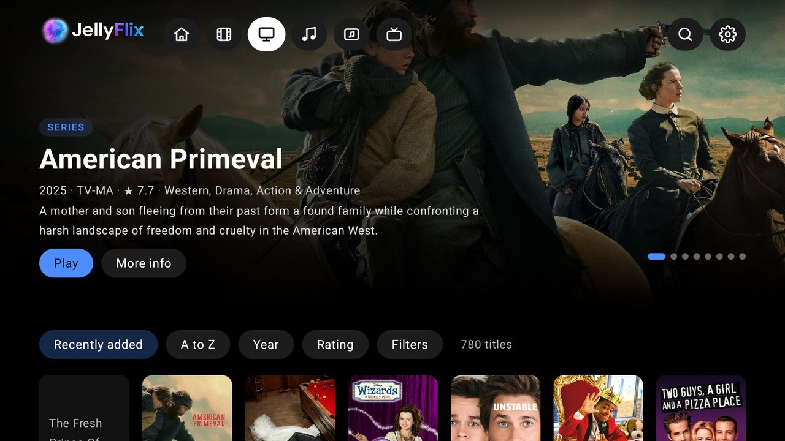
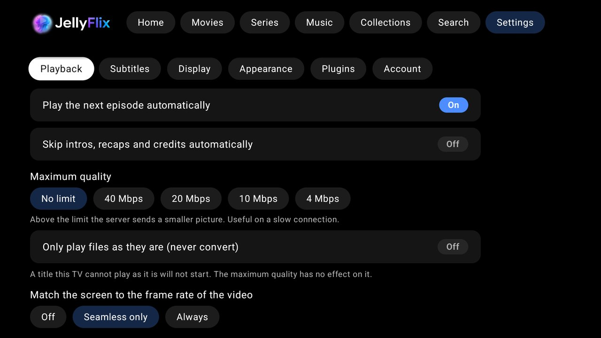

# Jellyflix TV

A native Android TV / Google TV client for your own Jellyfin server. Kotlin, Jetpack Compose for TV, Media3 (ExoPlayer) and the official Jellyfin Kotlin SDK. It talks only to the server you type in: no analytics, no other network calls,
and no addresses or credentials in the source (the session is kept in the app's private storage on the device).

It is the sibling of the web client in [`../web`](../web/README.md) and follows the same look and the same rules: the same sections in the same order, the same themes, English and Spanish.
What differs is how it is used: everything is built for a remote control and a TV seen from the sofa.

<p align="center">
  
  
</p>

**On this page:** [Features](#features) · [Remote control](#remote-control) · [Install it on your TV](#install-it-on-your-tv) · [Build and run](#build-and-run-development) · [How it is built](#how-it-is-built) · [Testing and compatibility](#testing-and-compatibility)

## Features

### Sign in
- **Sign in with a code (Quick Connect)** or with server address, user and password; the session and the last address are remembered. The screen shows a large six-digit code; you type it in Jellyfin on a phone or computer
  (user menu, Quick Connect, or the web client's Settings → Devices) and the TV signs in by itself, so nothing is typed with the remote. The server needs Quick Connect on (Dashboard → General).
- A rejected token (revoked from the Jellyfin dashboard) returns to the sign-in screen with a message; a network failure shows a message instead of closing the app.
- The tabs depend on the libraries the account has: Home, Movies, Series, Anime, Music videos, Books, Live TV, Music, Collections, Search, Settings. Appearance → Top menu changes their order and turns some off (Home stays; Search and Settings always stay at the right end), and Appearance → Menu buttons shows icons and names, only icons or only names. The bar scrolls with the remote, so Settings is always reachable.

### Home and discovery
- A rotating **banner** (the newest titles plus random picks, movies and series in turns, ten seconds each, paused while the remote is on it, the next picture loaded ahead), then **Discover something new** (a random movie, a series you never started,
  a random album, each with Play / Details / a refresh button), Continue watching, Next up, **Watch later**, your **playlists** and **favorites**, **New since your last visit**, **Coming up** (episodes about to air, with "Today", "Tomorrow" or the date),
  Latest movies, Collections, New series, New anime and **Because you watched X**. Each row is left out when it would be empty. Back from a title lands on the poster you left.
- **Movies, Series and Anime** open with a banner of their newest titles, then the sort and filter choices and the poster grid, as one page. **Music** opens with a wide random album. Every page starts clear of the top bar, so a focused button is never cut by it.
- **Search** across movies, series, collections, albums and artists.

<p align="center">
  
  
</p>

### Music videos, books and Live TV
- **Music videos**: a tab with wide cards (the artist under the title), a title page, the usual player, search, a "New music videos" row on Home and a place in Continue watching.
- **Books**: a tab with books and audiobooks. **Audiobooks** play in the music player from where they were left. Books to read are not shown on the TV: choosing one says so and points to the web app or a phone.
- **Live TV**: your channels with what is on each (quality and notes of the name as small tags), "now and next", a guide view, and favorites. Watching a channel opens the stream your server provides: no seek bar, OK shows the controls, up and down (or the remote's channel keys) change channel, and a channel the server cannot play shows a message. Recording and timers are not built.

### Your libraries
- **Movies, Series, Anime, Collections**: poster grids (six across at 1080p), sort by recently added, name, year or rating, more titles loading as you scroll. A long title scrolls by itself while its poster has the remote.
  In A–Z order a row of letters (#, A–Z) lets you jump to the first title that starts with one.
- **Filters** (the Filters button): watched or not, favorites only, genre, decade, minimum rating, age rating and 4K, all chosen from lists, applied with "Show results" and counted on the button.
- **A menu on every title** (movies, series, episodes): hold OK on a poster or a still and choose Open, Start over, mark as watched, add to or remove from favorites, Watch later, or add to one of your playlists (or a new one). What you choose shows at once.
- **Title pages**: artwork, year, runtime, rating, genres, overview, Play / Resume (with the time) / Start over, watched and favorite toggles, and the cast (choosing someone lists what else they are in).
  A line says what **Play** will give ("1080p HEVC · Spanish · AC3 · Stereo · 3 subtitle tracks"), and a movie in a collection has a **Part of the collection** button. A series has its seasons and episodes and plays the next unwatched one.
  A title with several files (1080p and 4K merged in Jellyfin) shows a **Version** row.
- **Playlists and Watch later** live on the server, so the web app sees them too. A playlist opens as a page: Play all (it goes on to the next title when each ends) and, holding OK on a title, remove, move earlier or later, or play from here.

<p align="center">
  
  
</p>

### Playback
- **ExoPlayer** with own controls. The server is asked how to play each title for this TV: it direct-plays what the TV can decode and converts the rest to H.264 + AAC over HLS (also the fallback when the audio cannot be decoded or the player fails).
- **Plays at the picture's own size.** At start the app asks the TV what it can do (which video decoders it has and the largest picture each takes, 10-bit, the HDR kinds the screen shows, which audio it can decode or pass through HDMI)
  and tells the server. A 4K file is sent as 4K and a 1080p file as 1080p; only what the TV cannot decode is converted.
- **Audio and subtitles menu** (text subtitles as separate files, image ones burned in by the server), **skip intro / recap / credits / preview** when the server has segments (Intro Skipper or another provider), a **Next episode** button in the last 25 seconds and autoplay.
- **Chapters**: a gap in the progress bar marks each one, the current chapter's name shows above it, a Chapters button lists them and the remote's next / previous keys go chapter by chapter.
- **Pictures on the seek bar** (trickplay) when the server has made them. Nothing is asked until the bar first shows, then only the one sheet that holds the picture is downloaded.
- **Info panel** (the Info button or the remote's Info key): how the title is played (as it is, or converted, with the picture copied or re-encoded and **why**), the file's container and bitrate, video, audio, what the player is decoding right now with dropped frames, and what the screen is doing.
- **Frame-rate matching**: "seamless only" asks the screen for the video's rate when that does not blink; "always" also switches the screen to the mode that suits the video (24 Hz for a film) and puts it back after.
- Position and watched state go back to Jellyfin. Errors are shown in plain words; a spinner shows while a video is being prepared and while it buffers.

### Music
- Overview (random album, shuffle all songs, jump back in, new albums, albums to try), all albums, artists and playlists; album, artist and playlist pages.
- A **now-playing bar** on every screen while music is queued, and a **full-screen player** with three faces chosen with three buttons along the bottom right: the cover and controls alone, the same with the **queue** beside them
  (with a **Reorder** mode: OK lifts a song, Up and Down move it, OK drops it), or the **lyrics** filling the screen. The **sleep timer** steps through off, 15, 30, 45, 60 minutes and "after this song".
- **Lyrics**: from the song's tags or a lyrics plugin such as LrcLib. Timed lyrics are large and centred and follow the music (press OK, then Up and Down choose a line and OK jumps the song there); lyrics without times scroll and offer
  **Find timed lyrics** (it asks the server's lyrics plugin and saves the result on the server; only an administrator may).
- Media keys on the remote work, and playing a video pauses the music. What is played is reported to Jellyfin.

<p align="center"></p>

### Appearance
Settings → Appearance (the choices stay on the TV):
- The web client's six **backgrounds** (true black, charcoal, midnight, dusk, pine, cocoa) and eight **accent colours**, used at once on every screen. Every pair is tested for contrast; there is no free colour, because nobody types a hex code with a remote.
  The chosen background is also behind the window, so a dark blue app does not start with a black flash.
- **Poster size** (compact, comfortable, large): rows and grids fit one more or one fewer column.
- **Home**: the banner on or off, and every row on or off and moved up or down (the focus goes with the row), with a button that restores the order.
- **Back up the look on the server**: *Save to the server* writes the look into your own Jellyfin user's display preferences and *Load from the server* reads it back, so another TV or the web app can use it. Only when you press a button;
  it holds these choices only (never your account or server address) and keeps whatever else the saved file has. The file is the web client's own format, so a look saved there loads here and the other way round.

<p align="center"></p>

### Stats and plugins
- **Your stats** (Settings → Account → Your stats): hours watched, movies and episodes, the last twelve months as bars, the most watched genres and what you watched more than once (choose one to open it). It is worked out on the TV from what the server already knows,
  reads at most the latest 1,500 movies and 2,500 episodes (it says so when cut) and sends nothing anywhere.
- **Playback Reporting in the stats**: when the server has the plugin and the account is an administrator, Your stats ends with a card of what it recorded: the real time played in 12 months, the plays, the share played as it is, the hours of the day you
  watch at and your devices. The app asks the plugin a few fixed read-only questions about the signed-in user; nothing is shown without the plugin.
- **Plugins** (Settings → Plugins, read only, administrators): which of Intro Skipper, Lyrics, Open Subtitles, TMDb Box Sets, Fanart.tv, AniList and Playback Reporting the server has, their version and state, and their tasks with progress and last result.
  Tasks are started from the web client.

### Other devices and Google TV
- **Play on the TV from another device**: while the app is open the TV shows up in Jellyfin's "Play on" list. From the web client you can start a title here and pause, resume, seek and stop it; songs, albums and playlists sent from another device
  start the music player (everything sent becomes the queue). The server only knows the TV while the app is open.
- **Continue watching on the Google TV home screen**: what you were watching and the next episodes appear in the TV's own row (written to the TV's local database, nothing is sent anywhere); choosing a card opens the app and plays it.
- **Instant Home**: the main page is saved on the TV when it settles and drawn straight away the next time the app opens, while the server answers and replaces it. The file holds titles and picture addresses only (no token or password), belongs to one user on one server and is deleted on sign out.

### Settings
In tabs (left and right move between the tabs, down goes into the open one):

| Tab | What is in it |
|---|---|
| **Playback** | play the next episode automatically (on), skip intros / recaps / credits automatically (off), **maximum quality** (no limit, 40, 20, 10 or 4 Mbps), **only play files as they are** (the server never converts; a title the TV cannot play as it is does not start and says why), **match the screen to the video's frame rate** |
| **Subtitles** | size, colour (white, yellow, cyan), background (shadow, box, none) and position, with a sample line |
| **Display** | text size (normal, large, larger) and **screen margin** for TVs that cut off the edges of the picture (everything except the video stays inside it), and what this TV plays |
| **Appearance** | see above |
| **Plugins** | see above |
| **Account** | who is signed in, Your stats, clear the picture cache, sign out (asks twice) |

<p align="center"></p>

English and Spanish, following the TV's language.

## Remote control

| Where | Key | What it does |
|---|---|---|
| Any screen | Back | Closes the page, then goes to Home, then leaves the app |
| Top bar | Down | Always lands on the section's first control (banner Play, sort choices, search box…) |
| A title | hold OK | Opens its menu |
| Video, controls hidden | OK / Play-Pause | Pause and show the controls |
| Video | Left / Right | Skip 10 s; held down it grows to 30 s and then 60 s |
| Video | Up / Down / Menu | Show the controls |
| Video, "Skip" or "Next episode" showing | OK | Presses it |
| Music (outside a video) | Play / Pause / Next / Previous / Stop | Drive the music |

## Install it on your TV

Jellyflix TV is installed by *sideloading* the APK, which works on Google TV (including TVs from TCL, Sony, Philips and others), Android TV, Chromecast with Google TV and Nvidia Shield, on Android 9 or newer.
You will need your **Jellyfin server's address as the TV reaches it**, such as `http://192.168.x.x:8096`: never `localhost`, which on the TV would mean the TV itself. Nothing about your server is inside the APK.

### 1. Get the APK

**Download it:** the [Releases page](https://github.com/sebastianvelezg/JellyFlix/releases) has `jellyflix-tv-<version>.apk`.

**Or build it yourself:** you need [Android Studio](https://developer.android.com/studio) (it brings Java and the Android SDK) and the project files. Open the `tv` folder in Android Studio and let *Gradle sync* finish once (it writes `tv/local.properties`).
Then, in a terminal inside `tv`:

```powershell
$env:JAVA_HOME = "C:\Program Files\Android\Android Studio\jbr"    # Windows; Linux and macOS: a JDK 17+ in JAVA_HOME
.\gradlew.bat assembleRelease                                     # ./gradlew assembleRelease elsewhere
```

The file is `app/build/outputs/apk/release/app-release.apk` (about 7 MB).

**Your own signing key (do this once, before the first install on your TV).** Android only lets an app update itself if the new APK is signed with the same key as the installed one. Without setup the release build is signed with a shared *debug* key, fine for trying it
but not for something you keep. Make your own key once and keep the file safe (back it up: if you lose it you must uninstall the app to install a build signed with another key):

```bash
keytool -genkeypair -v -keystore jellyflix.jks -alias jellyflix -keyalg RSA -keysize 2048 -validity 10000
```

Move `jellyflix.jks` into the `tv` folder and create `keystore.properties` next to it:

```properties
storeFile=jellyflix.jks
storePassword=the password you typed
keyAlias=jellyflix
keyPassword=the password you typed
```

`*.jks` and `keystore.properties` are ignored by the project's `.gitignore`. **Never share them or commit them.** From then on `assembleRelease` signs with your key.

### 2. Put it on the TV

First turn on developer options: **Settings → System → About → Android TV OS build** (or "Build"), press OK **7 times**; then **Settings → System → Developer options** and turn on **USB debugging** (and **Wireless debugging** if offered).
Find the TV's address under **Settings → Network & Internet** and keep the TV on the same network as your computer.

**adb over Wi-Fi (recommended).** `adb` is part of Android's *platform-tools* (Android Studio installs it under `Sdk/platform-tools`).

```powershell
adb pair <TV address>:<pairing port>          # only with Wireless debugging: enter the code the TV shows
adb connect <TV address>:<port>               # the Wireless debugging port, or 5555 with plain USB debugging
adb devices                                   # the TV must be listed as "device", not "unauthorized"
adb install -r <path to the APK file>
```

Accept the "Allow USB debugging?" prompt on the TV (tick *Always allow*). `Success` means it is installed, and **Jellyflix** appears in the apps row. `-r` keeps your data when updating.

**A USB stick.** Copy the APK to a FAT32 or exFAT stick, plug it into the TV, open it with a file manager app, allow installing from that source when asked, and press **Install**.

**The Downloader app** (no computer at the TV). Install *Downloader* from the TV's store and allow it to install unknown apps. Serve the APK from your own network (for example `python -m http.server 8000` in the folder that holds it),
then enter `http://<your computer's address>:8000/<the APK file name>` in Downloader.

### 3. First start, updating, removing

1. Open **Jellyflix**, enter the server address (the one your TV reaches), and choose **Sign in with a code** (type the six digits in Jellyfin on your phone: user menu → Quick Connect) or type the user and password.
2. Settings lets you change the subtitle look, the maximum quality, the text size, the screen margin and the appearance.
3. **Update** by building or downloading the new APK and running the same `adb install -r …`. Because it keeps the same signing key, your login and settings stay.
4. **Remove** it from TV Settings → Apps → Jellyflix → Uninstall, or `adb uninstall app.jellyflix.tv`.

| Symptom | Fix |
|---|---|
| `adb connect` fails or times out | The TV and the computer are on different networks, USB debugging is off, or the TV went to sleep. Wake it and retry; some TVs need the port shown on the Wireless debugging screen. |
| `adb devices` shows `unauthorized` | Accept the prompt on the TV; if it never appears: Developer options → *Revoke USB debugging authorizations*, then connect again. |
| `INSTALL_FAILED_UPDATE_INCOMPATIBLE` | The installed copy is signed with another key (for example the debug key before you made your own): `adb uninstall app.jellyflix.tv` once, then install. |
| `INSTALL_FAILED_VERSION_DOWNGRADE` | The TV has a newer version: use `adb install -r -d …` or uninstall first. |
| The app is not in the apps row | Wait a minute and restart the home screen, or Settings → Apps → See all apps → Jellyflix → Open. |
| Cannot sign in | Use the server's IP address, not `localhost`, and check the TV can reach it. |
| Black picture or no sound for some titles | Lower **Settings → Playback → Maximum quality**; the server converts what the TV cannot decode. |

## Build and run (development)

1. Android Studio → **Open** → the `tv` folder. Let Gradle sync finish.
2. Create a TV emulator once: **Device Manager → Create Virtual Device → TV → Google TV (1080p)**, and download a system image when asked.
3. Pick the device in the toolbar and press **Run**.
4. In the emulator use the arrow keys, Enter (OK) and Esc (Back). The server address is the one your computer uses to reach Jellyfin. Do not use `localhost`: inside the emulator that is the emulator itself (the host machine is `10.0.2.2`).

From a terminal:

```powershell
.\gradlew.bat testDebugUnitTest    # the JVM unit tests
.\gradlew.bat assembleDebug        # app\build\outputs\apk\debug\app-debug.apk (about 49 MB, for development)
.\gradlew.bat assembleRelease      # app\build\outputs\apk\release\app-release.apk (about 7 MB, shrunk with R8)
```

The release build is the one to judge speed by. It is signed with the debug key unless you made your own (see above). It is not a store build.

## How it is built

Stack: Kotlin, Jetpack Compose for TV (`androidx.tv:tv-material`), Media3 / ExoPlayer, Coil, the Jellyfin Kotlin SDK; `minSdk` 28.

- `data/` – `JellyfinRepository` (all SDK calls, mapped to plain `MediaItem`, `Album`, `PlaybackPlan`…), the models, and the **pure, unit-tested rules**: the banner line-up, settings, stream info and the rule that picks a screen mode for a frame rate,
  filters, playlists and Watch later, the visit window, the upcoming dates and the stats (`Insights.kt`), the look and its contrast maths (`Appearance.kt`, `AppearanceBackup.kt`), the Playback Reporting queries (`PlayHistory.kt`), trickplay, lyrics, the sleep timer, plugins.
  `TvCapabilities.kt` asks the TV's decoders, screen and audio output what they can play, and the repository turns that into the profile the server uses.
- `ui/` – the screens (`MainScreen`, `HomeScreen`, `LibraryScreen`, `MusicScreen`, `NowPlaying`, `DetailScreen`, `PlayerScreen`, `SettingsScreen`, `StatsScreen`…), `Components` (cards, pills, the focus helper) and `Theme` (state-backed colours that every screen reads).
- `AppViewModel` – tabs, a stack of pages, library paging, search, playback reporting, preferences and error handling. Repository calls run on `Dispatchers.IO`: the SDK reads each response on the calling thread, which must not be the main one.
  Every coroutine starts through `launchSafe`, which turns a failure into the error banner (and a 401 into the sign-in screen) without cancelling its siblings.
- `music/MusicPlayer` – the music queue and its ExoPlayer, kept for the whole session. `WatchNext.kt` – the Google TV home screen row.
- `res/values` and `res/values-es` – all texts; add every new text to both.

**Speed on a TV.** The release build is minified by R8 (7 MB instead of 49 MB; R8 must see the whole app). Pictures are requested at the size they are drawn and cached (18 % of the heap plus 256 MB on disk). Lists do not ask the server to count (every list call sets
`enableTotalRecordCount`, and a unit test fails if one forgets). At most four reads are on their way at once, what a screen is made of first and the slow extras last. Compose recomposes only what changes. Every focus request retries for about a second,
because on a fast device the first one can arrive before the screen exists.

**Jellyfin behaviours the app works around.** The server answers 401 to `api_key` and `X-Emby-Token`, so every request, ExoPlayer's included, sends `Authorization: MediaBrowser Token="…"`. `PlaybackInfoDto.mediaSourceId` has to be the id without dashes.
HLS playlists are full length, so the app seeks to the resume point. On a file played as it is, the audio track is chosen on the player's side. `/Items/Latest` is empty for series, so a sorted `/Items` query is used.
Jellyfin returns playlist ids without dashes, so they are never parsed as UUIDs.

## Testing and compatibility

- **Logic:** the pure parts have JVM unit tests (`./gradlew testDebugUnitTest`), including one that fails if a list call forgets to say whether it needs a count.
- **Screens:** checked by hand on the Android Studio `Television_1080p` emulator (Google TV, API 36) against a real Jellyfin 12.x server: sign-in with Quick Connect, Home, library grids with the letter jump, series and movie pages, search, Settings,
  music playback with the now-playing bar, video playback (direct play and the server's HLS conversion), the Info panel, chapters, the Google TV *Continue watching* row and a title started from the web app.
- **Devices:** Android TV and Google TV running Android 9 or newer. The emulator only offers software decoders and one 60 Hz mode, so a few things can only be confirmed on a real TV: HDR and Dolby decisions, 4K, the automatic frame-rate switch,
  a screen that crops the picture (the *Screen margin* setting) and the version picker for merged titles. If you try one of these, please [open an issue](https://github.com/sebastianvelezg/JellyFlix/issues/new/choose) with what you saw.
- **Servers:** developed against Jellyfin 12.x. Skip intro / recap / credits need segments from the server (for example the Intro Skipper plugin); without them the buttons simply do not appear.
- **Not built:** voice search, music playing after you leave the app, server discovery on the network, searching and downloading subtitles, recording and timers for live TV, a reader for books. Administration tools are on the web app only, on purpose.

## License

[MIT](../LICENSE), the same as the rest of the repository. The libraries it uses keep their own licenses: see [THIRD_PARTY_NOTICES.md](../THIRD_PARTY_NOTICES.md).
